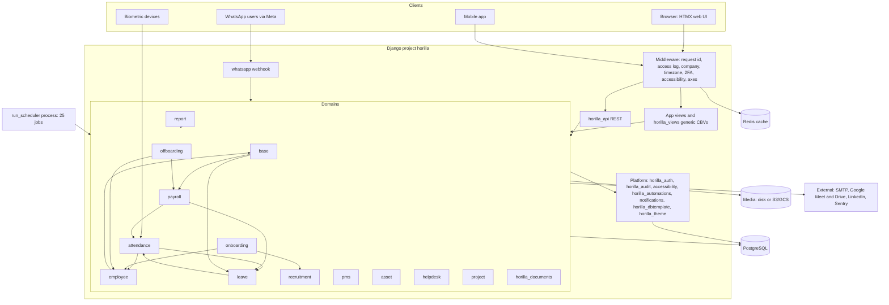
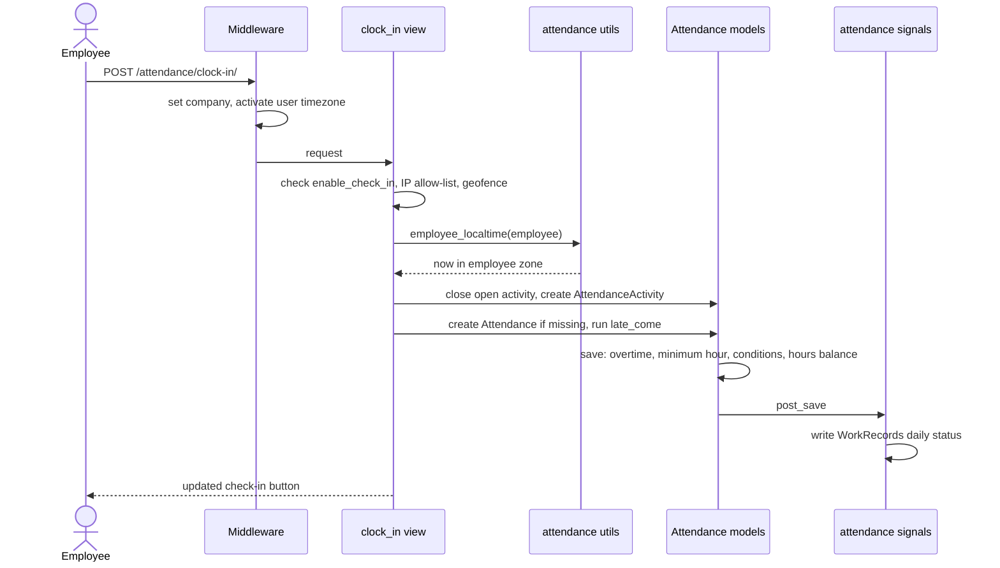
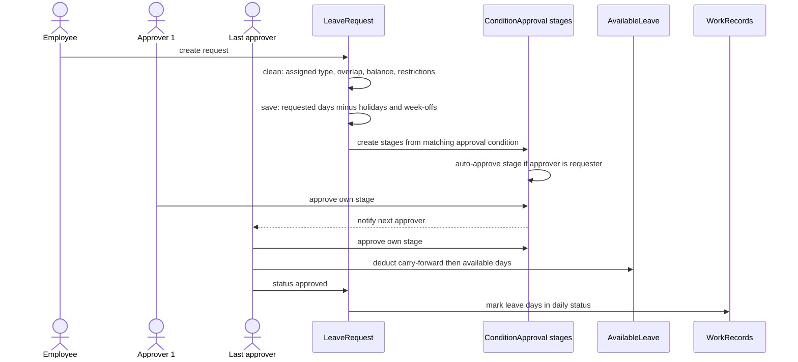
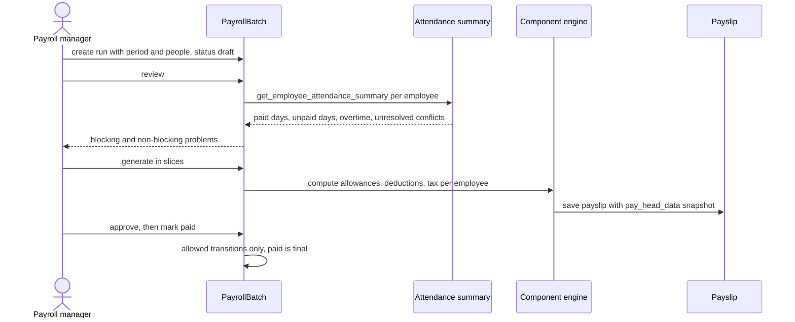
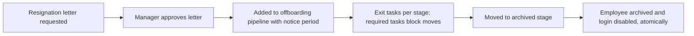
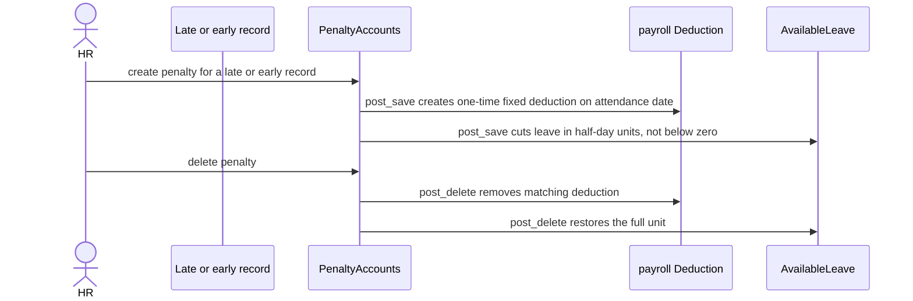

# Architecture: horilla-hr

Commit f2ab49933cfb40d295b3a9e65eba21996df2b0dc.

## Architecture Analysis

### System Overview
A single Django 5.2 project (`manage.py`, settings module `horilla.settings`) made of about 33 installed apps. It serves:
- a server-rendered web UI (Django templates + HTMX + Alpine.js, Tailwind theme) for HR, managers and employees;
- a REST API under `/api/` (DRF + SimpleJWT) for the mobile app;
- a WhatsApp Business webhook (`/whatsapp/`);
- operations probes `/health/`, `/ready/`, `/metrics/`.

Data lives in one PostgreSQL database (SQLite for a bare local run). Redis is the cache when `REDIS_URL` is set. Background jobs run in one separate process, `manage.py run_scheduler`, using APScheduler with a database job store. Media files go to local disk or S3/GCS.

### Architectural Style
**Modular monolith.** Evidence:
- one deployable image and one database (`Dockerfile`, `docker-compose.yml`);
- apps import each other's models, views and helpers directly (for example `payroll/methods/batch_run.py` calls `attendance.methods.utils.get_employee_attendance_summary`; `horilla_api` star-imports attendance views);
- side effects across apps run through Django signals in the same transaction (penalty → payroll deduction and leave cut, `base/signals.py:61-118`; leave → attendance work records, `leave/signals.py:15-92`);
- many apps register their own URL prefix at start-up from `AppConfig.ready()` by appending to `horilla.urls.urlpatterns`, and several patch other apps' classes at import time (`attendance/cbv/attendances.py:920-1009`).

Optional apps are guarded with `apps.is_installed(...)`, including conditional model fields (`base/models.py:3133-3175`, `leave/models.py:2440`), so the database schema depends on which apps are installed.

### Component Relationships

<!-- Text fallback: Browsers and the mobile app go through the middleware stack to the web views or the REST API; WhatsApp messages arrive at the whatsapp webhook; biometric devices feed attendance. All three entry points call the domain apps (base, employee, attendance, leave, payroll, recruitment, onboarding, offboarding, pms, asset, helpdesk, project, documents, report), which use the platform apps (auth, audit, accessibility, automations, notifications, DB templates, theme). Key dependencies: employee on base; attendance on employee and leave; leave on attendance (work records); payroll on attendance and leave; base signals write payroll deductions and leave cuts; onboarding on recruitment and employee; offboarding on employee and payroll; report reads all domains. A separate scheduler process runs 25 jobs against the domain apps. Everything persists to PostgreSQL, uses Redis as cache, stores files on disk or S3/GCS, and calls SMTP, Google, LinkedIn and Sentry. -->

### Data Flow
- **Request path (web)**: middleware sets a request id, captures a scrubbed JSON body for the access log (fork), resolves the active company into a ContextVar used by `HorillaCompanyManager`, activates the user's timezone (fork), enforces forced password change and optional 2FA, applies accessibility rules, then the view runs. `HorillaModel.save()` stamps `created_by`/`modified_by` from a thread-local request and runs the XSS check (`horilla/models.py:147-200`).
- **Request path (API)**: DRF authenticates with `TenantScopedJWTAuthentication`, which sets the company ContextVar and timezone because middleware runs before the token is known (`horilla/settings/base.py:112-120`).
- **Time capture**: web, API, biometric, Excel activity import and the auto punch-out job all call `attendance/views/clock_in_out.py`, producing `AttendanceActivity` and `Attendance` rows; `Attendance.save()` computes overtime and rebuilds the monthly hours balance; a post-save signal writes `WorkRecords` (daily status).
- **Pay calculation**: `attendance` Monthly Summary → paid/unpaid days and overtime → `payroll` component engine → `Payslip.pay_head_data` (JSON snapshot) → `PayrollBatch` totals.
- **Leave**: `LeaveRequest` save recomputes days and builds approval stages; approval adjusts `AvailableLeave`; a signal marks attendance `WorkRecords`; the 4-hourly reset job renews balances.
- **Notifications**: `notify.send` (in-app), `ConfiguredEmailBackend` with `EmailLog`, optional WhatsApp.

### Key Design Decisions

Each decision lists the context, the choice, its consequence, and the alternative the code comments or structure show was rejected.

1. **One scheduler process instead of per-worker schedulers** (`horilla/scheduling.py:1-30`).
   - Context: each gunicorn worker used to start its own `BackgroundScheduler`, so jobs such as payroll generation ran up to 8 times.
   - Decision: apps register jobs; only `run_scheduler` executes them, with a DB job store, `max_instances=1`, coalescing.
   - Consequences: run exactly one scheduler replica (`docker-compose.prod.yml` `replicas: 1`); jobs are not idempotent; `horilla_backup` and `biometric` still start their own schedulers.
   - Alternative rejected: per-process schedulers with locks.
2. **Company scoping by ContextVar-aware model managers** (`base/horilla_company_manager.py`, `base/middleware.py:210-422`).
   - Context: several companies in one database.
   - Decision: opt-in `HorillaCompanyManager` per model; permissions per company via `CompanyGroupAssignment` with a rollback switch `COMPANY_SCOPED_PERMISSIONS`.
   - Consequences: jobs and management commands see all companies; unscoped models must be found by a system check.
   - Alternative rejected: one database or schema per company.
3. **Payroll run as a state machine with a terminal Paid state** (`payroll/models/payroll_batch.py:140-172`).
   - Context: a paid run is a record of money that left the business.
   - Decision: allowed-transition table; Paid and Cancelled are final.
   - Consequences: corrections need a new run.
   - Alternative rejected: free status assignment.
4. **XSS check on every model save, not full validation** (`horilla/models.py:147-176`).
   - Context: full validation had been disabled and code came to depend on that; a GHSA advisory showed API saves stored raw markup.
   - Decision: call `clean_fields()` (XSS only) on every save.
   - Consequences: business validations in `clean()` still run only through forms; Django field choices are not enforced at model level (the fork's timezone fields add their own check, `base/models.py:134-145`).
   - Alternative rejected: re-enabling `full_clean()` globally.
5. **Per-user timezone at the request boundary (fork)** (`base/middleware.py:507-562`).
   - Context: punches were dated by the container's OS zone.
   - Decision: resolve employee zone → company zone → `TIME_ZONE`; activate it per request; take punch date/time in that zone.
   - Consequences: background jobs and some model validations still use server time.
   - Alternative rejected (implicit): a single project-wide `TIME_ZONE` for all companies.
6. **Production fail-closed gate** (`horilla/settings/security.py`).
   - Decision: refuse to start in production with default secrets, `*` hosts or the default setup password; secure cookies.
   - Alternative rejected: warnings only.
7. **Fork: no nginx in production** (commit fb8ff8eec, `docker-compose.prod.yml`).
   - Decision: gunicorn published on host port 1000 behind a tunnel; WhiteNoise serves static files.
   - Consequences: nginx's login rate limit, `/metrics/` deny and upload size limit are gone; client IP for axes and the IP allow-list depends on `AXES_PROXY_COUNT`.
   - Alternative rejected: keeping the bundled nginx.
   - Security implication: brute-force protection now relies on django-axes and DRF throttles only.

### Improvement Opportunities
- Make scheduled jobs timezone-aware per company and idempotent (several jobs use exact-date matches and server dates).
- Move leave balance deduction into one shared service used by web, API and auto-approval.
- Replace import-time monkeypatching and star imports with explicit extension points.
- Bring the biometric and Drive-backup schedulers under `horilla.scheduling`.
- Add record-level permission checks where `manager_can_enter` alone admits any manager.

## Interaction Diagrams

### Check-in from the web (with the fork's timezone)

<!-- Text fallback: The employee posts to the clock-in URL. Middleware sets the company and activates the employee's time zone. The view checks the check-in switch, IP allow-list and geofence, then gets the current time in the employee's zone. It closes any open activity, creates a new activity, creates the day's attendance if missing and checks for late arrival. Attendance save computes overtime and minimum hours and rebuilds the month's hours balance; the post-save signal writes the daily work status. The view returns the updated button. -->

### Leave request and multi-level approval

<!-- Text fallback: The employee creates a leave request. Validation checks the leave type is assigned, no overlap, enough balance and no restricted dates. Save computes requested days excluding holidays and weekly offs, then creates approval stages from the department's matching condition, auto-approving a stage whose approver is the requester. Approver 1 approves their stage and the next approver is notified. When the last approver approves, the balance is deducted (carry-forward first in the web path), the request becomes approved, and a signal marks the leave days in the daily work status. Note: the code completes the request when the last approver acts, even if earlier stages are still pending. -->

### Payroll run

<!-- Text fallback: The payroll manager creates a run for a period and set of people (draft). In review, the run asks the attendance summary for each employee's paid and unpaid days, overtime and unresolved conflicts, and reports blocking and non-blocking problems. Generation runs in slices: the component engine computes allowances, deductions and tax and saves each payslip with a JSON snapshot of its components. The manager approves the run and marks it paid; the state machine allows only defined transitions and paid is final. -->

### Hire to employee

```mermaid
flowchart LR
    A["Recruitment created"] --> B["Initial stage auto-created"]
    B --> C["Candidate applies: public form or HR entry"]
    C --> D["Pipeline stages: applied, test, interview"]
    D --> E["Hired stage"]
    E --> F["Onboarding stages and tasks"]
    F --> G["Onboarding portal: candidate fills personal and bank data"]
    G --> H["HR converts: user and Employee created"]
    H --> I["Employee work information, shift, leave assignment, contract"]
```

<!-- Text fallback: Creating a recruitment auto-creates its initial stage. A candidate applies through the public form or is entered by HR, moves through applied, test and interview stages to hired, then through onboarding stages and tasks. The candidate fills personal and bank data in the tokenised portal, and HR converts them into a user and an Employee, after which work information, shift, leave assignment and contract are set up. -->

### Offboarding to login removal

<!-- Text fallback: An employee submits a resignation letter and a manager approves it (approval itself has no automatic effect). The employee is added to an offboarding pipeline with a notice period; exit tasks run per stage and required tasks block stage moves. Moving the employee into the archived stage archives the employee record and disables the login in one transaction. -->

### Attendance penalty to payroll and leave

<!-- Text fallback: HR creates a penalty for a late-arrival or early-departure record. On save, a signal creates a one-time fixed payroll deduction on the attendance date and cuts leave in half-day units without going below zero. On delete, the matching deduction is removed and the full leave unit is restored, which can over-restore when the original cut was clamped at zero. -->
